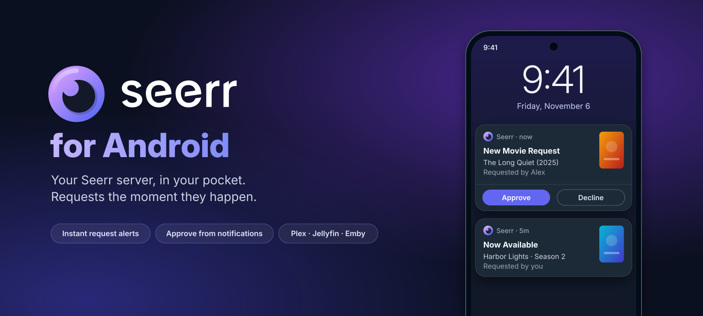
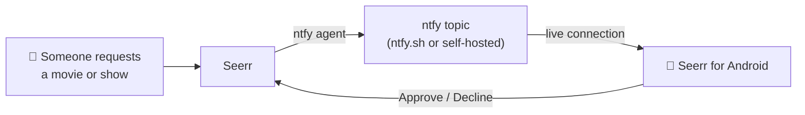

<p align="center">
  
</p>

<p align="center">
  <a href="https://github.com/RamenNuudlss/Seerr-Android/releases/latest"></a>
  <a href="https://github.com/RamenNuudlss/Seerr-Android/releases"></a>
  <a href="https://github.com/RamenNuudlss/Seerr-Android/actions/workflows/build.yml"></a>
  
  <a href="LICENSE"></a>
</p>

<p align="center">
  <a href="https://github.com/RamenNuudlss/Seerr-Android/releases/latest/download/Seerr-Android.apk">
    
  </a>
</p>

<p align="center">
  The Android app <a href="https://github.com/seerr-team/seerr">Seerr</a> never had.<br>
  Your server's full interface, plus <b>instant request alerts you can approve from the notification</b>.
</p>

---

> [!NOTE]
> This is an unofficial app made by a fan. It isn't affiliated with or endorsed by the Seerr team.

## ✨ Why use it

Seerr's web UI is already great on a phone, so the app shows **your own server's interface**: every page, every setting and every feature, always matching the Seerr version you run. What the app adds is everything a browser tab can't do:

<table>
  <tr>
    <td width="50%" valign="top">
      <h3>⚡ Instant request alerts</h3>
      Get a notification within seconds of someone making a request, with the poster attached. No waiting for a polling interval.
    </td>
    <td width="50%" valign="top">
      <h3>✅ Approve from the notification</h3>
      Tap <b>Approve</b> or <b>Decline</b> right on the alert, from the lock screen, without opening anything.
    </td>
  </tr>
  <tr>
    <td valign="top">
      <h3>🔔 Request status updates</h3>
      Get told when your own requests are approved, declined or ready to watch.
    </td>
    <td valign="top">
      <h3>🔑 Plex sign-in that works</h3>
      Plex sign-in opens in your browser, so Google, Apple and saved passwords work. The app takes you back when you're done.
    </td>
  </tr>
  <tr>
    <td valign="top">
      <h3>📱 Feels like an app</h3>
      Back closes modals first, pull down refreshes, and it runs edge-to-edge in Seerr's own dark theme, with fullscreen video and file uploads.
    </td>
    <td valign="top">
      <h3>🚀 Shortcuts &amp; sharing</h3>
      Long-press the icon for Discover, Requests and Profile. Share a TMDB link or a title from any app to open it in Seerr.
    </td>
  </tr>
  <tr>
    <td valign="top">
      <h3>🏠 Made for self-hosters</h3>
      Works with LAN <code>http://</code> addresses, your own certificates, basic-auth reverse proxies, and Authelia or Authentik login pages.
    </td>
    <td valign="top">
      <h3>🔄 Updates itself</h3>
      Checks this repo once a day and offers the new APK when there's a release.
    </td>
  </tr>
</table>

## 📥 Install

1. **[Download the APK](https://github.com/RamenNuudlss/Seerr-Android/releases/latest/download/Seerr-Android.apk)** on your phone.
2. Open it, and allow installs from your browser or file manager if Android asks.
3. Enter your server address, for example `https://requests.example.com` or `192.168.1.10:5055`, and sign in like you normally do.

Requires Android 8.0 or newer.

## ⚡ Instant alerts

Seerr has built-in [ntfy](https://ntfy.sh) notifications that fire the moment a request is made. The app keeps a lightweight connection to that ntfy topic, so you need no extra app, no Firebase and no polling.



**To turn it on:** long-press the app icon, tap **App settings**, then switch on **Instant new-request alerts**.

- **Seerr admins** get one-tap setup. The app switches on Seerr's ntfy agent using a private, randomly named topic on the free ntfy.sh service, or your own ntfy server. If Seerr already sends to ntfy, the app reuses that topic, so all your phones share it.
- **Everyone else** can enter the ntfy server and topic their admin gives them.
- **Allow background activity** when asked, so alerts still arrive instantly while your phone is asleep.

> [!TIP]
> Android requires a small silent "Instant alerts" notification while the connection is open. Long-press it and turn off **Background connection** to hide it. The alerts themselves keep working.

## ⚙️ App settings

Long-press the app icon and tap **App settings**. The same screen opens from the error page if your server can't be reached.

| Setting | What it does |
| --- | --- |
| **Server** | Shows or changes the Seerr server the app connects to |
| **Request notifications** | Alerts for your own requests being approved, declined or becoming available |
| **Instant new-request alerts** | Live alerts via ntfy, with Approve and Decline buttons |
| **Open Plex sign-in in browser** | Signs in to Plex through your browser, which supports Google, Apple and password managers |
| **Pull down to refresh** | Reloads the page when you swipe down at the top |
| **Sign out and clear data** | Clears the app's cookies, cache and saved logins |

## ❓ FAQ

<details>
<summary><b>Does it work with Overseerr or Jellyseerr?</b></summary>
<br>
The app works with any server that answers Seerr's API, which includes Overseerr and Jellyseerr, so browsing and requesting work. Instant alerts need a server with an ntfy notification agent, which Seerr has.
</details>

<details>
<summary><b>Where does my data go?</b></summary>
<br>
The app connects to three places: your Seerr server, the ntfy server (only if you turn on instant alerts), and GitHub's API once a day to check for updates. It has no analytics or tracking.
</details>

<details>
<summary><b>Will it drain my battery?</b></summary>
<br>
No. The instant-alert connection sits idle until a message arrives, with a tiny keepalive about every 45 seconds. It's the same approach the ntfy app uses. Request status checks run every 15 minutes, scheduled by Android.
</details>

<details>
<summary><b>Why isn't it on the Play Store?</b></summary>
<br>
It's a personal project. Releases are built and signed by GitHub Actions from this repo's source, and the app tells you when there's an update.
</details>

<details>
<summary><b>I don't see Approve / Decline on an alert</b></summary>
<br>
The buttons only appear for requests that are still pending, and only when you're signed in to Seerr in the app as someone who can manage requests.
</details>

## 🛠️ Building from source

Open the project in Android Studio, or run:

```bash
./gradlew assembleDebug
```

Every push to `main` is built by GitHub Actions. Pushing a tag such as `v1.2.0` publishes a signed release with the APK attached. Release signing reads the `SIGNING_KEYSTORE_BASE64`, `SIGNING_STORE_PASSWORD`, `SIGNING_KEY_ALIAS` and `SIGNING_KEY_PASSWORD` repository secrets.

## 💜 Credits

All the real work is [Seerr](https://github.com/seerr-team/seerr) by the Seerr team, along with the Overseerr and Jellyseerr projects before it. The logo and icons come from Seerr under the MIT License. This app just puts it in your pocket.

## 📄 License

[MIT](LICENSE)
